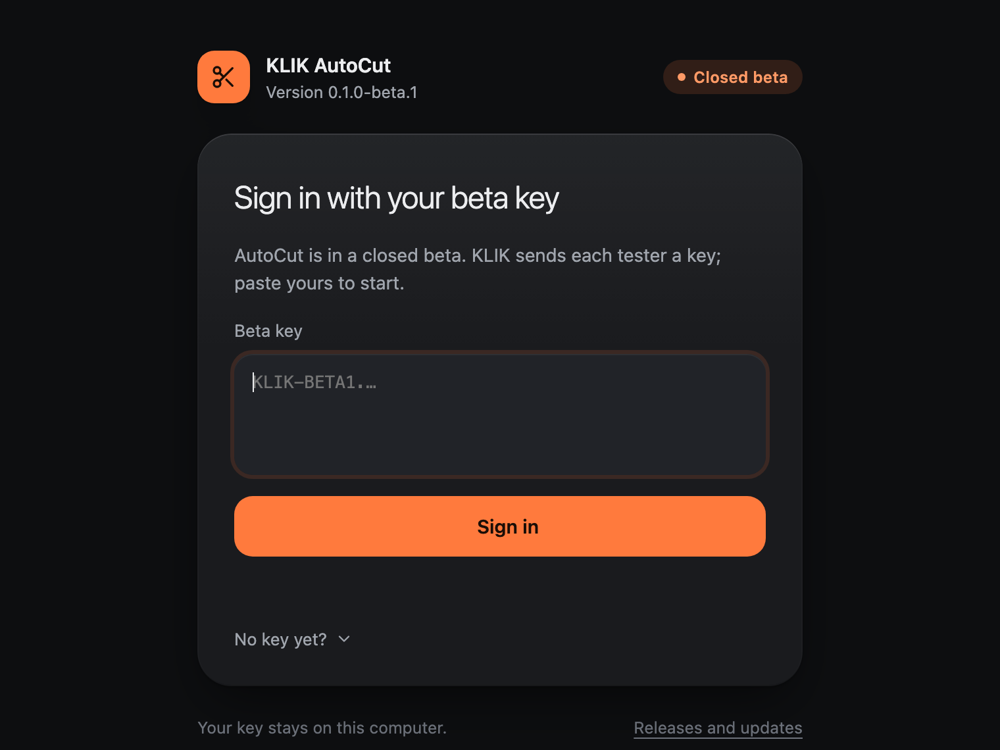

# Install KLIK AutoCut on a Mac

> [!IMPORTANT]
> **Closed beta.** Anyone can download AutoCut, but it only opens with a **beta key from KLIK**.

<p>
  <a href="https://github.com/t3knobox/klik-autocut-releases/releases/latest/download/KLIK-AutoCut-mac.dmg"></a>
</p>

**You need:** a Mac with Apple silicon (M1 or newer), macOS 13 or newer, Premiere Pro 2026.

## 1. Download and install

1. **Download** `KLIK-AutoCut-mac.dmg` with the button above.
2. **Open it** and drag **KLIK AutoCut** onto the **Applications** folder beside it.
3. Eject the disk image (the eject button next to "KLIK AutoCut" in the Finder sidebar).

Open AutoCut from **Applications**, not from the disk image: from there it can update itself.

## 2. Open it the first time

The beta isn't notarised by Apple yet, so macOS asks once before it opens it.

- **Right-click** (or Control-click) **KLIK AutoCut** in Applications → **Open** → **Open**.
- No **Open** button (macOS 15 and later)? Choose **Done**, then open **System Settings → Privacy & Security**,
  scroll down to *"KLIK AutoCut" was blocked*, choose **Open Anyway** and confirm with your password.

After that it opens like any other app.

<details>
<summary><strong>Is this safe?</strong></summary>

<br>

macOS asks because the beta isn't signed with an Apple Developer certificate yet, not because anything is wrong with it.
Every release lists the SHA-256 of each file in `SHA256SUMS.txt`; to compare, run
`shasum -a 256 ~/Downloads/KLIK-AutoCut-mac.dmg` in Terminal.

</details>

## 3. Sign in with your beta key

Paste the key KLIK sent you and choose **Sign in**. You only do this once; the key is kept in your Keychain.

<p align="center">
  
</p>

## 4. Connections

AutoCut starts on **Connections**:

1. **This computer** lists what AutoCut found. A yellow dot says what to fix:
   - **Premiere add-on**: the AutoCut add-on and its Premiere panel. KLIK sets it up with you.
   - **Node.js**: runs the add-on. `brew install node`, or the macOS installer from [nodejs.org](https://nodejs.org).
   - **Claude Code**: in Terminal, `curl -fsSL https://claude.ai/install.sh | bash`.
   - **ffmpeg**: `brew install ffmpeg`.
2. **Claude**: Sign in to Claude in the browser window that opens.
3. **ElevenLabs**: paste an API key with Speech to Text access, then Connect.

In Premiere: **Window → Extensions → MCP for Adobe Premiere Pro**, and keep the panel open while you use AutoCut.

## Optional: tagging new footage

Search, playback, books from the cloud, Auto B-roll and A-roll work straight away. **Tagging new footage** into a
Library book needs the models install (once; a few GB). In Terminal:

```bash
bash "/Applications/KLIK AutoCut.app/Contents/Resources/mac-models.sh"
```

Then reopen AutoCut. The models themselves download the first time you tag a book.

## Updates

AutoCut checks for a new version each time it opens. When one is out, an **Update** button shows at the top with what
changed. One click downloads it, checks it against the release's checksum, replaces the app and opens it again. Your
episodes and settings stay as they are. Check any time from **Settings → About → Check for updates**.

## If something's wrong

- **"KLIK AutoCut is damaged and can't be opened"**: macOS sometimes says this for apps downloaded outside the App
  Store. In Terminal: `xattr -dr com.apple.quarantine "/Applications/KLIK AutoCut.app"`, then open it again.
- **Update says to move it to Applications**: you opened it from the disk image or Downloads. Drag it into
  Applications and open it from there.
- **Self-test** for KLIK: in Terminal,
  `"/Applications/KLIK AutoCut.app/Contents/MacOS/KLIK AutoCut" --selftest ~/Desktop/klik-selftest.txt`, then send
  the file on your Desktop.

Your files are in `~/KLIK` (books, episodes, exports). Deleting the app leaves them.

[← Back to KLIK AutoCut](README.md) · [Install on Windows](INSTALL-WINDOWS.md)
