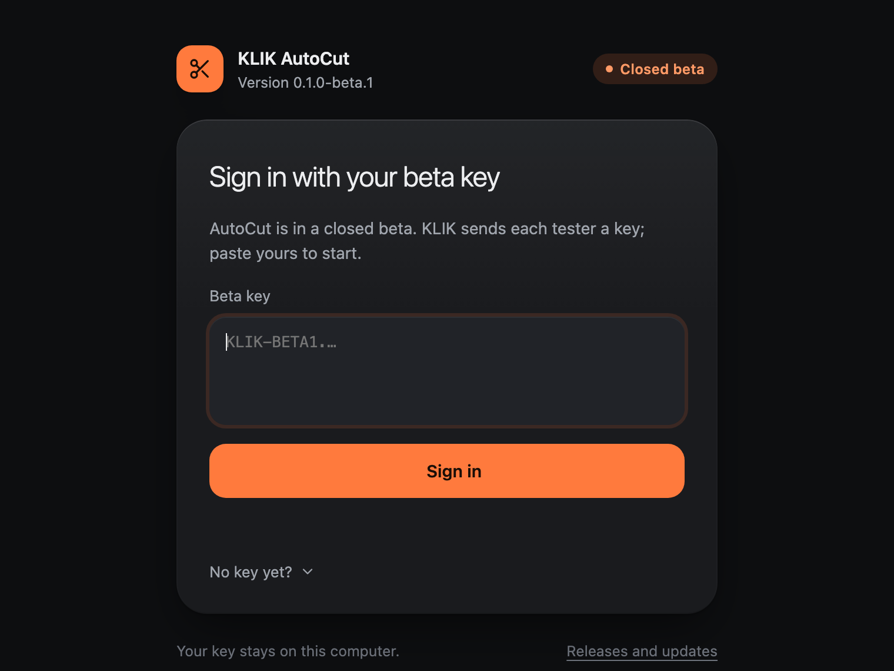

# Install KLIK AutoCut on Windows

> [!IMPORTANT]
> **Closed beta.** Anyone can download AutoCut, but it only opens with a **beta key from KLIK**.

  

**You need:** Windows 10 or 11 (64-bit), Premiere Pro 2026.

## 1. Download and install

1. **Download** the installer with the button above (`KLIK-AutoCut-Setup.exe`).
2. **Open it.** If Windows says it protected your PC, choose **More info**, then **Run anyway**. It installs just for
   you, with no administrator password, and adds **KLIK AutoCut** to the Start menu.

<strong>Windows protected your PC: why, and is it safe?</strong>

 

The beta installer isn't code-signed yet, so Windows SmartScreen doesn't recognise the publisher. Choose **More info →
Run anyway**. Every release lists the installer's SHA-256 in `SHA256SUMS.txt`; to compare, run
`Get-FileHash .\KLIK-AutoCut-Setup.exe` in PowerShell.

## 2. Sign in with your beta key

Paste the key KLIK sent you and choose **Sign in**. You only do this once; the key is kept in Windows Credential Manager.

  

## 3. Connections

AutoCut starts on **Connections**. **This computer** lists what it found (the Premiere add-on, Claude Code, ffmpeg);
a yellow dot says what to fix. KLIK sets up the Premiere add-on with you. Then sign in to **Claude** and paste an
**ElevenLabs** key with Speech to Text access. Keys stay in Windows Credential Manager.

In Premiere: **Window → Extensions → MCP for Adobe Premiere Pro**, and keep the panel open while you use AutoCut.

**Tagging new footage** into a Library book stays on the Mac for now (its model needs Apple silicon). Books tagged on
a Mac and put in the cloud work fully on Windows: Library → In the cloud → Download.

## Updates

When a new version is out, an **Update** button shows at the top with what changed. One click downloads it, checks it
against the release's checksum, installs it and opens AutoCut again. Your episodes and settings stay as they are.
Check any time from **Settings → About → Check for updates**.

[← Back to KLIK AutoCut](README.md) · [Install on Mac](INSTALL-MAC.md)
