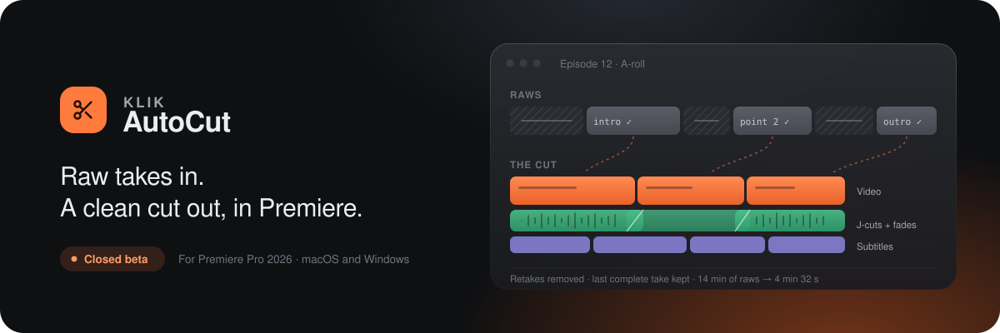
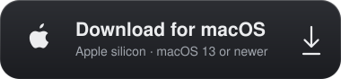
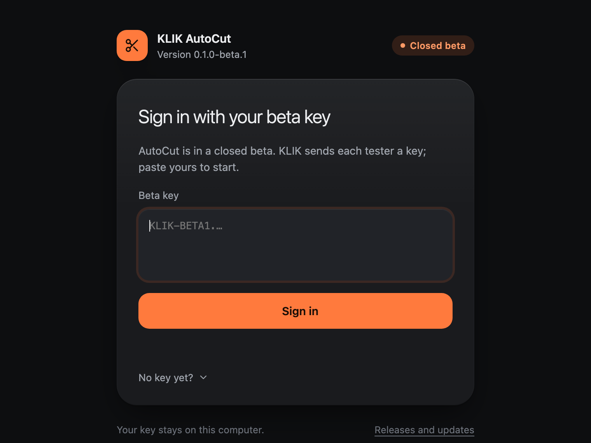
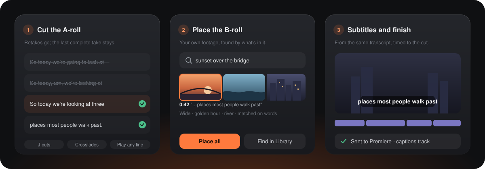

  

  
  
  

  <a href="#install">Install</a> &nbsp; / &nbsp;
  <a href="#what-it-does">What it does</a> &nbsp; / &nbsp;
  <a href="#what-you-need">What you need</a> &nbsp; / &nbsp;
  <a href="https://github.com/t3knobox/klik-autocut-releases/releases">Releases</a>

> [!IMPORTANT]
> **KLIK AutoCut is in a closed beta.** Anyone can download it, but it only opens with a **beta key from KLIK**. If you're one of our testers, your key is on its way to you.

## Install

  
  &nbsp;
  

**[Install on Mac →](INSTALL-MAC.md)** &nbsp; · &nbsp; **[Install on Windows →](INSTALL-WINDOWS.md)** &nbsp; · &nbsp; [Release notes & checksums](https://github.com/t3knobox/klik-autocut-releases/releases/latest)

### On a Mac

1. **Download** `KLIK-AutoCut-mac.dmg`, open it and drag **KLIK AutoCut** onto **Applications**.
2. **Open it the first time** with right-click → **Open** → **Open**. On macOS 15 and later, if there's no Open button: **System Settings → Privacy & Security → Open Anyway**. The beta isn't notarised by Apple yet, so macOS asks once.
3. **Sign in with your beta key** from KLIK.
4. **Connect your accounts** on the Connections screen: Claude and ElevenLabs. Keys stay in your Keychain.

Apple silicon, macOS 13 or newer. The full steps, including the optional models install for tagging footage: [INSTALL-MAC.md](INSTALL-MAC.md).

### On Windows

1. **Download** `KLIK-AutoCut-Setup.exe` and open it. If Windows says it protected your PC, choose **More info**, then **Run anyway**. It installs just for you, with no administrator password.
2. **Sign in with your beta key** from KLIK.
3. **Connect your accounts** on the Connections screen: Claude and ElevenLabs. Keys stay in Windows Credential Manager.

Windows 10 or 11, 64-bit. The full steps: [INSTALL-WINDOWS.md](INSTALL-WINDOWS.md).

  

## Updates

AutoCut checks this page for a new version each time it opens. When one is out, an **Update** button shows at the top with what changed. One click downloads it, checks it against the release's checksum, installs it and opens AutoCut again, on Mac and on Windows. Your episodes and settings stay as they are.

You can check any time from **Settings → About → Check for updates**. Every release's notes are on the [releases page](https://github.com/t3knobox/klik-autocut-releases/releases).

## What it does

AutoCut turns talking-head raws into a tidy edit inside your own Premiere project, then gets out of the way so you can finish it.

  

- **Cuts the A-roll.** It transcribes the raws, removes retakes and false starts, and keeps the last complete take. You check it as a **paper edit**: read it like a script, play any line, bring back anything it cut, or tell it in plain words what to change.
- **Joins it properly.** J-cuts and audio crossfades at every join, in your sequence, so it sounds edited, not chopped.
- **Places B-roll from your own footage.** Make a **Library** of your footage folders and search it in plain words ("sunset over the bridge"). Auto B-roll suggests a shot for each moment; swap any of them, then **Place all**. Talking-to-camera clips never become B-roll.
- **Writes the subtitles** from the same transcript, timed to the cut, onto a captions track.
- **Leaves you in charge.** It edits a working copy of your raws sequence, never writes to shared drives like LucidLink, and any step can be stopped.

## What you need

| | |
| --- | --- |
| **Computer** | Windows 10 or 11 (64-bit), or a Mac with Apple silicon |
| **Premiere Pro** | 2026, with the AutoCut add-on (KLIK helps you set it up). On a Mac, also Node.js |
| **Claude** | Your own Claude subscription, signed in through Claude Code. AutoCut uses it to read the transcript and plan the edit |
| **ElevenLabs** | An API key with Speech to Text access, for transcripts. Transcripts use that account's credits |
| **Beta key** | From KLIK. You'll need it to sign in the first time |
| **Optional** | Cloudflare R2, to keep Library books in the cloud |

**Windows and Mac do the same edits.** One part stays on the Mac for now: tagging new footage into a Library book uses a model that needs Apple silicon. Books tagged on a Mac and put in the cloud work fully on Windows.

## Help

Something not right? Tell your KLIK contact what you were doing and what you saw, and include your version from **Settings → About**. Lost your key, or need one for a new teammate? Ask KLIK for a new one.

---

<strong>About this repository</strong>

 

This is KLIK AutoCut's public home for installers, release notes and update files. Each release carries the Mac disk image (`KLIK-AutoCut-<version>-mac.dmg`, and the same file as `KLIK-AutoCut-mac.dmg` for the button above), the Mac app zipped for updates (`KLIK-AutoCut-<version>-mac.zip`), the Windows installer (`KLIK-AutoCut-Setup-<version>.exe`, and the same file as `KLIK-AutoCut-Setup.exe`), `latest.json` and its signature, which the app checks before offering an update, and `SHA256SUMS.txt`. `revoked.json` lists beta keys that no longer work.

The application source is kept in a separate private repository. GitHub's automatic **Source code** archives contain only this page's files, not the app.

© KLIK Creatives. Closed beta: features and requirements may change between releases.

